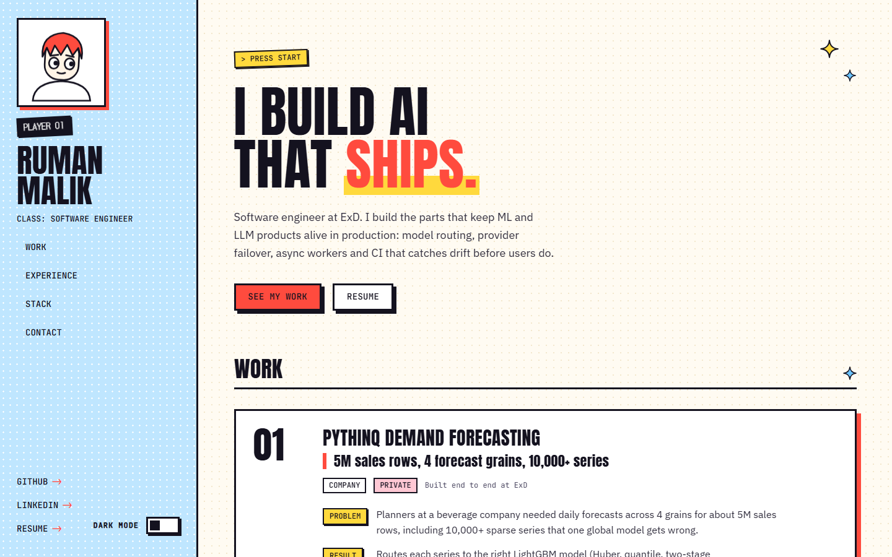

# Ruman Malik — portfolio

Personal portfolio of Ruman Malik, an AI engineer. A single-page site with a bright, restrained HUD look: pixel stickers, 3px ink borders, hard offset shadows and halftone dots. Light theme by default, dark theme opt-in.

**Live site: [rumanmalik.vercel.app](https://rumanmalik.vercel.app)**



Highlights:

- Entry sequence and an illustrated avatar that reacts to the cursor and scroll
- Lazy halftone planet in the hero (Three.js, loaded after the content)
- Resume preview dialog with a downloadable PDF
- Content-complete without JavaScript: all hero text is in the server HTML
- First-load JavaScript budget of 150 KB gzipped, WCAG 2.2 AA checked with axe in light and dark
- No CMS, no backend, no contact form (mailto only), fully static

## Tech stack

Next.js 16 (App Router, Cache Components), React 19, TypeScript (strict), Tailwind CSS 4, Motion, Lenis, React Three Fiber, Playwright, pnpm. Deployed on Vercel.

## Quick start

```bash
pnpm install          # pnpm 12 is pinned via "packageManager"; use corepack or `npm i -g pnpm`
cp .env.example .env.local
pnpm dev              # http://localhost:3000
```

Requires Node 20.9 or newer (`.nvmrc` pins 20).

Before sending changes, run the full check and the required tests:

```bash
pnpm check                    # typecheck + lint + format check + production build
pnpm build && pnpm test:e2e   # Chromium desktop + mobile (required)
```

First Playwright run: `pnpm exec playwright install chromium` (add `firefox webkit` only if you use `test:e2e:all`).

## Scripts

| Script                | What it does                                                         |
| --------------------- | -------------------------------------------------------------------- |
| `pnpm dev`            | Dev server                                                           |
| `pnpm build`          | Production build (fully static; fonts are downloaded at build time)  |
| `pnpm start -p 3100`  | Serve the production build                                           |
| `pnpm typecheck`      | `tsc --noEmit`                                                       |
| `pnpm lint`           | ESLint (Next core-web-vitals + TypeScript + React Compiler rules)    |
| `pnpm format`         | Prettier (write)                                                     |
| `pnpm test:e2e`       | **Required.** Chromium desktop + mobile against the production build |
| `pnpm test:e2e:all`   | **Best-effort.** Also Firefox + WebKit, 1 worker, longer timeouts    |
| `pnpm test:e2e:fresh` | Build, then `pnpm test:e2e`                                          |
| `pnpm check`          | Typecheck, lint, format check and build, in order                    |
| `pnpm resume:pdf`     | Writes `public/resume-generated.pdf` from `resume.json`              |
| `pnpm resume:preview` | Rebuilds `public/resume-preview.webp` from `public/resume.pdf`       |
| `pnpm stack:icons`    | Rebuilds icon colors and `public/stack-sprite.svg` from Simple Icons |

Firefox and WebKit builds of Playwright can fail to launch on some Windows machines even when Chromium is green; reinstall with `pnpm exec playwright install firefox webkit --force` if they crash before `newPage`. The `scripts/` folder also holds bundle-size and Lighthouse helpers used while tuning performance.

## Making it your own

> The code is MIT licensed, but the content, resume and avatar are mine and are not covered. See [License](#license). If you fork this, replace them with your own before publishing.

Every word on the site lives in **`src/content/content.ts`**. Locked UI chrome and intro lines are in `src/content/chrome.ts` (imported by `content.ts`); feature flags are in `src/content/features.ts`. Client components import `chrome` / `features`, never `content.ts`. Components contain no copy.

- `site`: name, title, description (SEO), email, location, employer, keywords.
- `socials`: GitHub, LinkedIn and the resume path.
- `hero.lines`: the headline. The **last word of the last line** becomes the red accent word with the yellow highlight.
- `hero.pitch`: the paragraph under the headline.
- `intro.lines`: the dialogue typed out in the entry sequence. Two or three short lines work best.
- `projects`: ordered list; numbering (`01`…) follows array order. Each project has `kind` (`company` | `university` | `personal`), `ownership`, `headline`, `problem`, optional `result`, `validation` (how it was checked), `flow` (3 to 5 plain steps drawn as a numbered diagram), `stack`, optional `links` (`live`, `code`, `paper`) and `confidential` (shows `PRIVATE`).
- `experience`: real jobs and internships. Each role has a short `summary` and an optional `projects` list of Work titles. `end: 'Present'` renders as `PRESENT`.
- `stack`: groups of tools. Each item has a `name`, an optional Simple Icons `icon` slug, and an optional `mono` label for tools without an official logo. After changing slugs, run `pnpm stack:icons`.
- `writing`: leave empty and the Writing section and its nav item are omitted.
- `features`: `intro`, `planet`, `smoothScroll` switches.
- `ui`: the locked UI wording (`PLAYER 01`, `> PRESS START`, section titles…). Change with care.

Long values, empty arrays and missing optional fields are all handled; the layout does not break.

### Resume

`public/resume.pdf` is the file visitors download; replace it when your resume changes, then run `pnpm resume:preview` to rebuild the preview image shown in the dialog (a test fails if the preview is older than the PDF). `pnpm resume:pdf` writes a separate `public/resume-generated.pdf` from `src/content/resume.json` and never touches `resume.pdf`. A test (`tests/resume-privacy.spec.ts`) checks that the public resume and preview contain no phone number.

### Avatar

The avatar is an inline SVG in `src/components/avatar/AvatarSvg.tsx` (viewBox `0 0 120 120`). Keep the element structure (the head `<g>`, the two eye `<ellipse>`s and the two pupil `<circle>`s receive refs) so `useAvatarMotion.ts` can keep driving pupils, head tilt and blinks. The favicon (`src/app/icon.svg`), the Apple icon (`src/app/apple-icon.tsx`) and the 404 page reuse the same geometry; update them too. Colors use tokens: hair `--accent`, outlines `--ink`.

## Environment

| Variable               | Purpose                                                                                                 |
| ---------------------- | ------------------------------------------------------------------------------------------------------- |
| `NEXT_PUBLIC_SITE_URL` | Public origin without a trailing slash. Drives canonical URLs, Open Graph, sitemap, robots and JSON-LD. |

Resolved in `src/lib/site-url.ts`, the only place that reads this variable:

- **Production** (`VERCEL_ENV=production`): required. Must be `https://…` with no trailing slash, no path and no `localhost`, or the build throws.
- **Preview**: if unset, falls back to `https://${VERCEL_URL}`.
- **Local**: defaults to `http://localhost:3000`.

Copy `.env.example` to `.env.local` for local work. Validator coverage lives in `tests/site-url.spec.ts`.

## Deploying on Vercel

1. Import the repository in Vercel. Next.js is detected automatically.
2. Add `NEXT_PUBLIC_SITE_URL=https://your-domain.com` to Production (and Preview if you want a fixed preview origin).
3. Deploy. The whole site is prerendered at build time, including the Open Graph image, sitemap and robots.txt. No database or server is involved.

Web Analytics is wired through `@vercel/analytics` in the root layout. Enable it in the Vercel project (Analytics → Enable), or remove `<Analytics />` from `src/app/layout.tsx`. Nothing else third-party is loaded.

## Design and behaviour notes

- **Tokens.** All colors, spacing and fonts come from CSS variables in `src/app/globals.css`. Radius is 0 everywhere; Tailwind's radius utilities are disabled.
- **Theme.** An inline script in `<head>` sets `data-theme` before first paint from `localStorage`. With nothing stored (or storage blocked) the site is light. The OS preference is never consulted.
- **Entry sequence.** Shown once per browser (an `intro-seen` flag in `localStorage`); skipped for deep links, reduced motion, data saver, landscape phones and bfcache restores. A CSS failsafe hides it after 6 s if JavaScript never runs, and every line auto-advances after 8 s so nobody gets stuck.
- **Performance.** First-load JavaScript stays under 150 KB gzipped for modern browsers. Three.js, Lenis, the avatar springs, the intro scene and Motion's animation engine are separate chunks loaded after hydration or on idle. Only `transform` and `opacity` are animated (the one exception is the work card hover shadow).
- **Reveals.** Nothing is hidden in the server HTML, so the page is complete without JavaScript. Elements are hidden only on the client before the first post-hydration paint, never when already in view without the intro, and always shown instantly under `prefers-reduced-motion`.
- **Accessibility.** Landmarks, one visible `h1`, skip link, visible focus rings, 44 px targets, `aria-live` for copy-to-clipboard, a modal dialog for the intro and resume with focus restore. `tests/a11y.spec.ts` runs axe-core with WCAG 2.2 AA and best-practice rules in both themes.

## Project structure

```text
src/
  app/            layout, page, not-found, globals.css, metadata routes (OG image, icons, sitemap, robots, manifest)
  content/        content.ts (all copy), chrome.ts, features.ts, resume.json, stack icon data
  components/
    shell/        Sidebar, MobileHeader, Nav, ThemeToggle, FloatingEmail, Footer, Boot, Enhancements, SmoothScroll, JsonLd
    sections/     Hero, Work, WorkList, ProjectCard, Experience, MobileDetails, Stack, StackTips, Writing, Contact, CopyEmail
    avatar/       AvatarSvg, AvatarTile, Avatar, AvatarMotion, useAvatarMotion
    intro/        Intro, IntroSequence, IntroLoading, IntroScene, useIntroState
    resume/       ResumeDialog, ResumeFolder, ResumeTriggers
    three/        Planet, PlanetLoader, StaticPlanet
    ui/           Button, Tag, Sticker, Sparkle, Reveal, ProfileLinks, ErrorBoundary
  lib/            site-url, motion, device, storage, theme, scroll, intro-state, animate, reveal, env, head-scripts
  assets/fonts/   Anton + JetBrains Mono for the OG image, DotGothic16 latin slice (all OFL)
scripts/          resume and stack-icon builders, bundle-size and Lighthouse helpers
tests/            Playwright specs: smoke, a11y, resume, resume-privacy, planet, wide-layout, hover-clipping, site-url
public/           resume.pdf, resume-preview.webp, stack-sprite.svg
```

## Project status

Live and maintained. This is a personal site, so there is no roadmap or versioned release.

## Contributing and support

This is my personal portfolio, so I am not accepting content changes (copy, projects, resume or design direction). Bug reports for the code are welcome: please [open an issue](https://github.com/rumanmlk/portfolio/issues) with the browser, device and steps to reproduce. For anything else, use the contact section on the [live site](https://rumanmalik.vercel.app).

If you fork this, `pnpm check` and `pnpm build && pnpm test:e2e` are the same gates I use, so a green run means the site still works.

## Security

See [SECURITY.md](SECURITY.md) for how to report a vulnerability. The site is fully static, has no backend, database or user accounts, and stores only two values in `localStorage`: the theme choice and an intro-seen flag. Vercel Analytics is the only third-party script.

## Credits

Built with [Next.js](https://nextjs.org), [React](https://react.dev), [Tailwind CSS](https://tailwindcss.com), [Motion](https://motion.dev), [Lenis](https://lenis.darkroom.engineering), [Three.js](https://threejs.org) and [Playwright](https://playwright.dev). Fonts: Anton, JetBrains Mono and DotGothic16 (SIL Open Font License). Tool logos in the Stack section come from [Simple Icons](https://simpleicons.org).

## License

The source code is released under the [MIT License](LICENSE). The site's text content, resume files, avatar artwork and personal branding are **not** covered and remain all rights reserved; see the Exclusions section in [LICENSE](LICENSE). Fonts are under the SIL Open Font License, and Simple Icons logos are trademarks of their respective owners.
